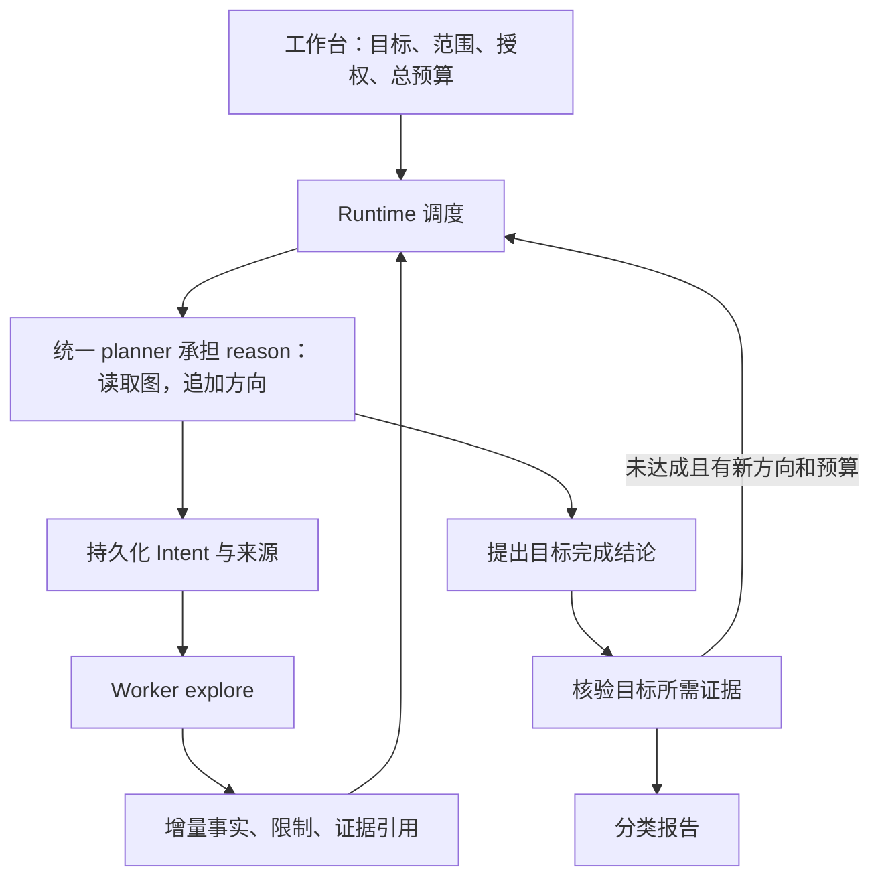

# Cairn 动态搜索源码研究

研究日期：2026-10-12。通过 GitHub API 核对，上游 HEAD 为 `8e7e0ea67552383851dfcabfba0c4e9c8d007878`（2026-09-07）。以下基于该版本源码，区分已有实现、源码限制与本项目建议。本次仅研究与记录，不改执行逻辑，也不启动安全任务。

## 结论与前次判断修正

Cairn 的核心是共享事实图驱动的任务调度：图发生有意义的变化时，运行 `reason` 追加探索方向；`explore` 沿一个方向执行并写回增量事实。它没有预先生成整份固定步骤表。

本项目 `an` 主编排器确实没有自动重规划回边，但 `security-runtime` 已有同样的 bootstrap/reason/explore 调度和触发条件。因此，把整个系统归为“只有静态流水线”不准确。实际架构是主工作台包裹动态搜索 Runtime。需要检查的是规划职责、进展同步、工具能力、预算和证据语义，而不能仅凭主编排器没有回边就断言缺少搜索。

## 1. 状态以图持久化

上游 `server/models.py` 定义：

- `Fact`：`id`、`description`。
- `Intent`：`id`、`from[]`、`to`、`description`、`creator`、当前 `worker` 和时间戳。
- `Hint`：人工输入的提示。
- `Project`：origin/goal 所属项目及 active/stopped/completed 状态。

`from[]` 表示一个方向所依赖的事实，`to` 表示该方向产出的新事实。多个输入通过同一个 Intent 汇合。Worker 是领取任务的执行者，不是连接历史分支的公共图节点。

`server/db.py` 使用 SQLite，保存 projects、facts、intents、intent_sources、hints，以及 ID 计数器。连接启用 WAL、外键；写入失败回滚。

`routers/intents.py::conclude` 在同一个事务里创建 Fact、设置 Intent.to 和 concluded_at。因此一条来源关系有持久化依据，刷新画布无需重新推断。

源码：[模型](https://github.com/oritera/Cairn/blob/8e7e0ea67552383851dfcabfba0c4e9c8d007878/cairn/src/cairn/server/models.py)、[持久化](https://github.com/oritera/Cairn/blob/8e7e0ea67552383851dfcabfba0c4e9c8d007878/cairn/src/cairn/server/db.py)、[结论写入](https://github.com/oritera/Cairn/blob/8e7e0ea67552383851dfcabfba0c4e9c8d007878/cairn/src/cairn/server/routers/intents.py#L122)。

## 2. 三种任务的职责

| 任务 | 输入 | 输出与作用 |
|---|---|---|
| bootstrap | Origin、Goal、Hints | 初始时直接尝试解决；成功返回 Fact 和 Complete；超时可进入 conclude 保存进展 |
| reason | 全图快照、可引用事实 ID、所有未结束 Intent | 判断目标是否达成；追加多个 Intent；已有方向覆盖线索时可以不追加 |
| explore | 全图快照、一个 Current Intent | 探索这个方向，返回一条增量事实描述 |

bootstrap 可禁用，也会受 Worker 能力影响；初始阶段可以直接 reason。

reason 返回的新方向形如：

```json
{
  "accepted": true,
  "data": {
    "intents": [
      {"from": ["f001"], "description": "检查登录接口是否存在限速"},
      {"from": ["f001", "f002"], "description": "验证异常响应的产生条件"}
    ]
  }
}
```

它每轮追加方向，不替换既有事实和历史。`reason.md` 要求先看目标、再看已有方向是否覆盖线索，新增方向要有价值、可独立执行、避免重复。一个 Intent 可以依赖多个事实。

没有 open intents 且没有完成目标时，协议不允许普通空输出；模型可以明确 rejected。上游 prompt 中“不能拒绝”等措辞不是值得照搬的设计，本项目应保留明确的授权、能力与停止原因。

源码：[reason prompt](https://github.com/oritera/Cairn/blob/8e7e0ea67552383851dfcabfba0c4e9c8d007878/cairn/src/cairn/dispatcher/prompts/default/reason.md)、[输出协议](https://github.com/oritera/Cairn/blob/8e7e0ea67552383851dfcabfba0c4e9c8d007878/cairn/src/cairn/dispatcher/contracts.py#L65)。

## 3. 什么触发下一轮规划

`scheduler/loop.py::_reason_trigger` 比较上次 reason 输入的计数快照，检查：

1. Fact 数量增加。
2. Hint 数量增加。
3. 原来还有 open intents，现在变成零。

非初始项目没有正在运行的 reason，且满足以上条件时，优先调度 reason；否则消费未领取 Intent。reason 可以与其他 explore 并行，但同一项目最多一个 reason lease。

成功 reason 的 checkpoint 记录的是调度时的输入计数。reason 运行期间产生的新事实不会因为结束时覆盖 checkpoint 而被忽略，下一轮可以再次触发。

没有变化时不重复 reason。未领取 Intent 的选择采用 created_at 最新者优先；源码没有完整的价值评分、语义去重或公平队列。它是模型引导的探索调度，不是具有搜索完备性保证的 BFS/A*。

源码：[调度选择](https://github.com/oritera/Cairn/blob/8e7e0ea67552383851dfcabfba0c4e9c8d007878/cairn/src/cairn/dispatcher/scheduler/loop.py#L254)、[触发条件](https://github.com/oritera/Cairn/blob/8e7e0ea67552383851dfcabfba0c4e9c8d007878/cairn/src/cairn/dispatcher/scheduler/loop.py#L704)。

## 4. 探索失败与程序失败是两回事

探索结论可以是“某条件下这条方法没有得到预期效果”。`explore` 协议只要求有效且非空的 description，没有要求命中成功利用关键词。这样的结论可以写成 Fact，再触发 reason。

原始 prompt 要求已经确认的客观结论；它没有规定每个失败进程必须产出事实，也没有自动证明否定结论的完整覆盖范围。

进程崩溃、租约丢失或无法生成有效结果时，Dispatcher 释放 Intent，让其以后可以重新领取，不伪造一个探索结论。失败后反复领取仍可能浪费预算，Cairn 没有替本项目解决所有重试治理问题。

bootstrap/explore 超时或解析失败时，在适配器支持、有同一会话、租约有效且项目仍 active 的情况下，可以继续该 session，发出 conclude prompt。该 prompt 要求立即停止动作，只总结已经确认的增量结果。收尾阶段也有独立超时；无法收尾则释放任务。

源码：[探索执行与收尾](https://github.com/oritera/Cairn/blob/8e7e0ea67552383851dfcabfba0c4e9c8d007878/cairn/src/cairn/dispatcher/tasks/explore.py)、[conclude prompt](https://github.com/oritera/Cairn/blob/8e7e0ea67552383851dfcabfba0c4e9c8d007878/cairn/src/cairn/dispatcher/prompts/default/explore_conclude.md)。

## 5. 并发、超时与工具能力

Dispatcher 负责领取、heartbeat、选择 Worker、启动进程以及协议写回。Worker 接受 prompt 并返回结果，不直接维护图协议。

约束包括全局并发、项目并发、Worker 并发、单次 reason 新增 Intent 数、各阶段执行超时和租约超时。`dispatch.example.yaml` 中 bootstrap/explore 为 300 秒，conclude 为 90 秒，reason 最多新增 2 条方向；这些是示例配置，不是不可变常量。

heartbeat 防止健康执行者的任务被误领；任务执行超时限制单轮耗时，二者用途不同。停止项目会取消进程并跳过 conclude fallback。

所读协议和调度代码没有本项目 bounded_http 的“每 Intent 120 次 HTTP 调用”规则。这不表示没有任何约束，也不能从这里推出调用越多越好。

Worker 在项目环境里运行 Agent CLI。Pi 执行阶段启用 read/write/edit/bash 等工具；项目容器共享工作文件，长日志可保存文件并在事实中引用。这个能力边界与本项目必须通过 MCP 桥接工具执行的边界不同，单独缩短 prompt 不会增加工具能力。

源码：[配置](https://github.com/oritera/Cairn/blob/8e7e0ea67552383851dfcabfba0c4e9c8d007878/dispatch.example.yaml)、[Pi 适配器](https://github.com/oritera/Cairn/blob/8e7e0ea67552383851dfcabfba0c4e9c8d007878/cairn/src/cairn/dispatcher/workers/adapters/pi.py)。

## 6. 完成判断的实际强度

reason 返回 `complete.from[]` 与理由后，Dispatcher 调用服务端 complete。bootstrap 直接解决时也可走完成路径。

`routers/projects.py::complete_project` 检查项目 active、来源事实存在、来源不包含 goal，然后创建来源指向 goal 的结束 Intent，并把项目置为 completed。

该路径没有独立验证器去重放请求、核验附件或判断漏洞实际成立。原始 Fact 只有 id/description，也没有本项目的 finding_id/evidence_id/verification_status。Cairn 在这层主要依靠模型与 prompt 的客观事实要求。

因此，应该借鉴其搜索循环与来源引用，保留本项目对证据和漏洞确认的独立验证。事实可供规划参考、漏洞候选已确认、最终目标已经达成，需要分别表达。

源码：[完成接口](https://github.com/oritera/Cairn/blob/8e7e0ea67552383851dfcabfba0c4e9c8d007878/cairn/src/cairn/server/routers/projects.py#L257)。

## 7. 对当前项目的对应与建议

| 部分 | 当前本地源码情况 | 建议 |
|---|---|---|
| Runtime 动态循环 | 已有 bootstrap/reason/explore；reason 触发同样检查 facts/hints/open intents | 复用现有循环，先排查事实是否及时写回、reason 是否被正确触发 |
| 主工作台 planner | 初始生成计划；渗透强制一条 penetration_module；运行期间等待 Runtime 终态 | 明确它是目标编排层，还是要承担搜索规划；统一职责再接入增量规划 |
| 双层规划 | Runtime 执行 reason，主 planner 不接收每轮完整进展再决策 | 保留一个追加 Intent 的决策入口；如需主 planner 参与，把它接到 Runtime 的 reason 阶段 |
| 事实与报告 | 负面与未验证事实已保留为 Worker 报告，但摘要仍可能称为已确认事实或安全问题 | 分类展示已证实事实、有限范围的否定结果、待验证候选、证据不足记录，分别计数 |
| 证据 | 画布已支持结构化条目与证据引用 | 不把记录存在、工具成功或模型陈述当作漏洞确认 |
| 预算 | bounded_http 为每 Intent 120、每运行 400；Runtime explore prompt 另要求每轮至多 12 次安全工具调用 | 区分总预算、单轮预算、租约；实际触发哪个约束需查运行事件，不能单凭源码推断某次卡住原因 |

推荐职责：



上述对应表记录研究时的源码快照。2026-10-14 核对后的实现已将绑定工作台的项目接入统一 Planner：`blackboard_coordinator.py` 保存 `planning_mode=workbench`；Runtime 的 `dispatcher/tasks/reason.py` 在 `reason_provider=workbench` 且项目带有工作台标记时调用工作台规划，再原子提交决策。普通 Runtime 项目保留自己的 Reason 路径。

当前故障排查应检查这条回调链、意图轮次、工具回执和事实写入；不要依据旧表再增加第二个追加 Intent 的入口。已修复问题、实际运行证据与验收限制见仓库 `docs/penetration-failure-2026-10-13.md`。

不要只给 verify 添加 plan 回边：当前 plan 非空时不会运行 planner，渗透计划校验只允许一条模块调用，而且远端任务已存在时重跑提交步骤可能产生重复项目。需要先定义同一项目内的续探协议、增量计划 ID、完成判定及总预算。

本次研究没有重放“渗透30”，也没有证明任何原始漏洞结论。以上关于本项目的对应来自当前本地源码，部署版本及运行配置需另行核对。
