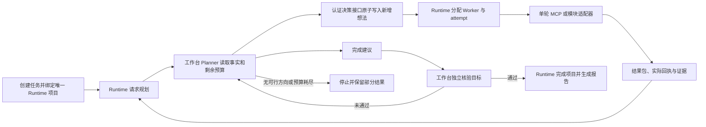

# 工作台持续规划与 Runtime 执行

实施日期：2026-10-13。此版本复用 Security Runtime 的 reason/explore 调度和同一项目黑板。新任务由工作台 Planner 决定探索方向，Runtime 负责调度、Worker 租约和结果写入；旧任务沿原状态恢复。

## 执行流程

核验未通过时，同一次规划回调最多进行一次有界修订，给出新的验证方向或停止原因。正在执行或等待审批的想法仍保留在黑板上。失败和超时不会自动被重新领取；Planner 显式指定 `retry_intent_id` 后，Runtime 才允许建立新的 attempt。重试保留原来源事实和历史执行记录。

新任务不再把“调用整个渗透模块”作为唯一静态计划步骤。工作台进入 `runtime_wait` 后等待同一项目的持续探索，不另启动长期模块规划循环。

## 三类单轮工具

| 任务 | 本轮执行入口 | 范围与限制 |
|---|---|---|
| 渗透 | Pi Worker 经黑板 MCP 工具目录调用已连接安全工具 | 按任务授权 URL、网络策略和审批限制执行；不重复提交 penetration_module 项目 |
| 代码审计 | MCP 工具及 `workspace_security_audit` | 适配器使用任务工作区和 `analysis_backend=local`，结果为本轮观察、候选与证据 |
| 逆向 | MCP 工具及 `reverse_module` | 本地适配器只做 PE/ELF 格式、大小、哈希初筛；反编译、导入表和进一步验证需要对应 MCP 工具 |

工具目录提供工具完整参数协议和版本。调用时检查当前项目、Worker、attempt、工具版本及授权范围。代码审计和逆向模块也遵守任务的逐次审批策略。Pi 的内置可执行工具被限制，实际安全工具经工作台接口调用。

## 内部接口与幂等

- `POST /api/v1/internal/runs/{run_id}/planning`：Runtime 向工作台发送任务/项目绑定、触发原因、目标和授权范围、黑板快照、预算。使用 `X-Security-Runtime-Token` 认证。
- `POST /projects/{project_id}/planning/decisions`：Runtime 原子应用认证决策，创建想法、调度重试、停止或写入已核验完成建议。新工作台项目不能通过普通创建想法接口绕过 Planner。
- `GET /projects/{project_id}/events?after=...&limit=...`：按游标读取持久执行事件。工作台将 Runtime 事件同步到 ledger，按项目事件 ID 去重并经现有 WebSocket 推送。
- `POST /api/v1/mcp/blackboard/{project_id}/{intent_id}/invoke`：执行单轮工具；`request_id` 对应持久回执。响应丢失后重用同一 ID；执行中的回执继续等待，不重复调用或计费。
- 同一路径下 `/model/reserve` 和 `/model/complete`：Pi 在真实模型请求前原子预留任务预算，返回后幂等结算用量。

决策 ID 由项目 ID 和快照摘要生成；心跳时间不计入摘要。工作台持久保存回调结果，Runtime 用事务保存决策及图修改。相同 ID 重放返回原结果，ID 被用于不同快照或快照过期时拒绝应用。创建项目使用 run 幂等键，响应丢失不会再建一个项目。任务/项目、目标、模块和授权范围不一致时拒绝规划。

执行链为 `run_id → project_id → intent_id → attempt_id → call_id → fact_id/evidence_id`。工具开始和完成记录使用同一绑定；回调只接受产生该结果的 Worker、attempt 与实际回执。Worker 的候选 ID 被限定在当前项目和结果包，不能覆盖其他分支的发现。

## 结果、核验与报告

一次探索仍产生一个结果包，兼容 `Intent.to`，包内 `items` 可含事实、观察、漏洞候选和附件。条目拥有稳定 ID、短标题、摘要、证据引用；原始工具结果保存在回执中。负面结论可作为 `outcome=negative` 的事实留存。

工具执行状态、漏洞验证状态和项目目标达成独立处理：

- 工具成功只表示工具完成；不会确认漏洞或完成项目目标。
- 漏洞候选经独立证据核验后才进入已确认或已排除。证据缺失、引用属于其他结果包或核验不足时保持待验证/证据不足。
- Planner 的完成建议必须引用与黑板结果关联的真实工具证据，由工作台核验器再次检查原始目标。Runtime 的完成状态还须有工作台持久核验记录及有效证据，才能将运行标为完成。
- 无新方向、预算耗尽或目标核验未通过时保留部分结果，报告明确停止原因。报告分别展示已确认发现、已排除方向、待验证候选、证据不足和执行限制；历史记录及缺少证据的陈述显示为 Worker 报告。

报告刷新读取持久结果和核验记录，不发起新探索或把普通事实转换为漏洞。历史任务及旧描述格式仍可读取。

## 预算

新任务默认总预算为 **600 次工具调用**；普通任务默认 **200 次模型请求**，渗透任务默认 **600 次模型请求**，由工作台 Settings 和环境变量配置。当前默认运行时间为渗透任务 2400 秒、其他任务 600 秒，可在任务创建时调整至 7200 秒。Planner、核验器和 Pi Worker 共用模型请求预算；并发工具调用通过数据库原子预留，审批等待和同请求重放不重复计费。

`GET /api/v1/task-budget-defaults` 返回当前服务的默认预算及可选范围。任务创建和重试页面读取该接口，允许设置总运行时间、工具调用总量和模型请求总量。创建及重试请求均支持 `max_runtime_seconds`（60–7200 秒）、`max_tool_calls`（1–100000 次）、`max_model_calls`（1–10000 次）；限制由后端校验。

已有任务恢复时继续使用已保存预算，不自动扩大。重试 API 省略工具或模型预算时继承原任务的对应值；重试界面展示当前默认值与原预算中较大的值，供操作者修改后提交。任务创建、重试和重复请求均持久保留选定预算，修改预算不能重用已提交的请求 ID。

通用 `blackboard_max_mcp_calls_per_intent` 默认为空，不再使用每想法 120 次的封锁。操作人员仍可配置额外总工具限制 `blackboard_max_mcp_calls_per_run`，或专门的意图限制；这些均不能放宽授权及高风险工具策略。

Pi 每轮默认不设工具次数上限：Worker 环境变量 `SECMIND_MAX_TOOL_CALLS` 未设置或为 `0` 时，由 Dispatcher 的 `tasks.explore.timeout`、`conclude_timeout` 控制执行与收尾时间。显式设置正整数仍可启用额外的单轮次数限制；负数、小数或无效值拒绝启动扩展。单轮收尾后交回 Planner 决定下一轮；任务总预算耗尽则停止整个项目。任务总时间耗尽时工作台请求停止 Runtime 项目，避免前台结束后后台继续探索。

网络策略仍独立执行授权限制。`bounded_http` 保留每想法 120 次、每任务 400 次的专项请求上限；`session_http` 没有专项次数上限，但仍受任务总时间、工具和模型预算约束。扩大探索预算不能放宽网络范围、审批或证据核验。

## 画布与执行清单

沿用 Cytoscape 执行画布与 `schema_version: 1.1` 的 `nodes/edges`。投影增加公开规划摘要、来源事实、验证目标、成功条件、attempt、Worker、真实工具、耗时、结果条目和预算。选择想法或结果可以追溯来源，查看原始回执及证据。界面显示可审计的决策摘要，不展示模型隐藏推理。

执行状态包括待执行、执行中、等待审批、完成、失败、超时和取消。只在实际执行分支上展示活动；只有租约而没有工具记录时显示“执行中，暂无工具记录”。多结果包默认摘要展示，所有条目和证据可搜索。

## 启动与兼容

默认路径是本地 Pi：`security-runtime/start-runtime-dispatcher.ps1` 转到 `start-runtime-dispatcher-pi.ps1`，加载 `dispatch.pi.local.yaml`；独立 Pi 配置 `dispatch.pi.independent.yaml` 也使用 `runtime.reason_provider: workbench`。

`scripts/planning-credential.ps1` 被工作台和 Runtime 启动脚本共同加载。已设置 `SECURITY_RUNTIME_CALLBACK_TOKEN` 时复用该值；否则原子创建 `_runtime/planning-callback.token`，多个进程同时启动读到同一凭证。凭证不写入画布、Prompt 或 Worker CLI，并从本地 Worker 的环境中移除。跨主机部署须在两端设置相同内部凭证，并将 `workbench_url` 指向可达工作台地址。

新任务需要本地执行、启用 `pi_blackboard_extension` 的 Pi Explore Worker 和可用模型配置。当前首期逐请求预算支持 Pi；使用只有 Claude Worker 的配置时，新工作台项目会明确停止并说明缺少支持的 Worker。独立 Runtime 项目和旧任务仍保留原执行路径。

此次没有重启正在运行的正式服务。重启工作台 API、Runtime Server 和 Dispatcher 后，新建渗透、代码审计和逆向任务进入新流程；旧运行按已有绑定与计划恢复。演示模式继续使用原本地路径。

## 验证记录

已覆盖初始规划、并行方向、事实续探、多来源汇合、完成核验通过/拒绝、无方向与预算停止、失败后显式重试、候选独立核验、负面事实、原生适配器审批、工具回执重放、错误 attempt、回调认证及项目绑定。

持久化与并发覆盖项目创建重放、决策重放/重启、过期快照、并发模型和工具预算预留、终态后用量结算、旧快照保存不覆盖新结果、Dispatcher 丢响应后复用同决策 ID。共享凭证验证了 8 个并发启动的一致性和临时文件清理。

前端已有测试、构建和浏览器回归已通过；浏览器用固定 300 个结果条目、30 个想法检查折叠、搜索、来源追溯、视角保持、重连与事件合并、明暗主题、窄屏和减少动态效果。

最终回归结果（含本次预算配置调整）：

| 检查 | 结果 |
|---|---|
| 工作台后端全量 pytest | 568 通过，4 跳过 |
| Runtime 后端全量 pytest | 164 通过 |
| Pi 黑板扩展 Node 测试 | 13 通过（含子测试） |
| 前端 Node 测试 | 41 通过 |
| 前端生产构建 | 通过 |
| 黑板浏览器回归 | 通过 |
| 创建与重试预算浏览器回归 | 通过；编辑、空值、明暗主题、窄屏、响应丢失重放 |
| 实际启动路径 PowerShell 语法 | 6 个脚本通过 |
| 共享凭证并发初始化 | 8 个并发启动一致 |

以上使用 Mock Worker、模拟回执与浏览器固定数据；没有调用真实模型或对真实目标执行渗透。完整逆向能力取决于部署的工具连接，不能用本地格式初筛代替。

本次预算调整只需在方便时重启工作台 API 和 Dispatcher；未修改 Runtime Server 的配置加载逻辑。新默认值仅用于新运行，已有任务预算保持不变。浏览器回归使用独立 Vite 端口和模拟 API，不连接正式任务。
