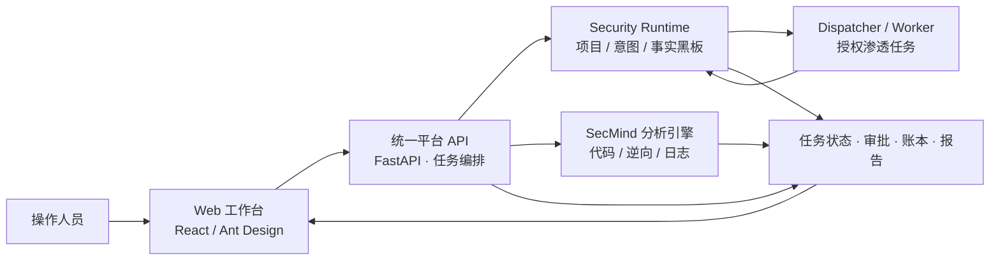

# SecMind：可追溯的多场景安全任务智能体平台

> 项目类比赛技术讲解稿。本文描述当前交付目录中的实现；演示效果和测试结论以实际运行回执为准。

## 一、项目定位

SecMind 面向安全分析中常见的一个断点：模型可以给出建议，安全工具可以产出结果，但任务分发、工具授权、证据归属和报告结论往往分散在不同系统里。一旦任务跨模块执行，操作人员很难回答三个问题：**工具为什么被调用、它实际看到了什么、报告中的结论由什么证明。**

本项目把这些环节组织成一个本地安全任务平台。用户提交代码、日志、样本或授权目标后，统一工作台识别任务类型并制定步骤；黑板为每一步固定工具分配和执行意图；对应分析引擎执行任务；系统把工具回执、证据、审批和结论关联到同一运行记录，最后生成可回放的报告。

**一句话介绍：**SecMind 让安全智能体从“会分析”进一步走向“能受控执行、能说明依据、能恢复任务”的工程系统。

## 二、系统架构

| 组件 | 当前职责 | 本地默认端口 |
| --- | --- | ---: |
| Web 工作台 `an/frontend` | 创建任务、查看实时流程、审批、报告回放、模型及工具管理 | 5173 |
| 统一平台 `an/src/security_agent` | 输入校验、场景分类、规划、路由、预算、状态恢复、证据汇总 | 8001 |
| Security Runtime | 保存项目、事实和执行意图；校验 Worker 租约与工具调用边界 | 8000 |
| Dispatcher | 领取已启用的渗透项目，调度本机 CLI Worker；本身不提供 Web 端口 | — |
| SecMind | 执行代码审计、静态逆向、日志调查和证据验证 | 8002 |

部署层面采用组件解耦：前端只访问统一 API；统一 API 按任务类型与独立引擎通信。代码审计可选择本地静态规则或 SecMind 完整流程；渗透任务通过 Runtime 项目和 Dispatcher 执行。普通任务也必须先建立黑板项目和步骤意图，随后由统一平台执行被分配的工具。

## 三、一项任务如何跑完

以“上传一个待审计源码包并生成报告”为例：

1. **接收材料。**上传入口检查文件与压缩包边界，建立任务工作区和材料清单，保留相对路径与来源。
2. **识别场景。**分类器结合输入材料和目标，识别为代码审计、逆向、日志分析、渗透测试等场景；不确定的输入保留人工研判入口。
3. **制定计划。**主 Agent 生成有依赖、有预算、可验证的步骤；计划校验检查工具候选与执行约束。
4. **登记执行意图。**黑板项目记录当前任务，步骤意图固定工具分配。Guardrail 和审批在真正执行前再次核对项目、意图、授权范围和工具参数。
5. **受控执行。**工具返回的结果进入任务账本；MCP 调用保存连接、调用 ID、意图 ID、Worker 和结果回执。代码审计的完整分析可由 SecMind 执行。
6. **验证并报告。**系统把发现与具体证据绑定。证据不足、外部引擎未完成或超时的任务保留 `partial` 状态，不把未证实内容包装为已完成结论。
7. **复盘与复用。**页面可以回放事件流；经审核的经验进入经验库，供后续同类任务检索和规划。

这条流程的关键是：**报告不是模型的一段自由文本，而是带任务身份、工具回执和证据来源的结果投影。**

## 四、值得重点讲的技术设计

### 1. 黑板是工具执行的共同入口

每个任务绑定黑板项目，每个待执行步骤对应一个意图。工具调用前校验项目状态、意图分配、Worker 租约、任务工作区、授权目标、工具版本与预算；停止、过期、改派或已收束的意图不能继续调用。黑板 MCP 调用默认设置任务级和意图级次数上限，并在发送调用前持久化占用。

这样可以把“模型建议使用某工具”和“系统允许该工具以这些参数运行”分开。对普通任务，统一编排器仍负责步骤顺序和后续规划；黑板负责工具分配、租约、门禁与回执。渗透项目则由 Dispatcher 调度 Worker。

### 2. 证据链贯穿输入、执行和结论

统一平台保存任务状态、事件账本、工具回执和报告；SecMind 对 Finding 与 Evidence 做独立校验。任务页面的资产引用图区分“授权范围”“输入材料”“实际调用目标”和“工具明确发现的资产”，不会把一次调用直接算成扫描覆盖。回放页面可以按事件查看工具何时执行、结果如何进入分析和报告。

答辩时可以用一句话解释：**每个重要结论都要能回指到一次运行、一个输入或一条工具证据。**

### 3. 长任务可以恢复，但不盲目重放

运行快照记录下一节点、审批和外部任务绑定。服务重启后，系统优先恢复已有任务并查询已知外部 ID；已经完成的工具步骤不会重新执行。对于“远端可能已接受请求，但本地没有收到回执”的非幂等操作，系统保留不确定状态，要求核对，而不是自动再发一次。超时、取消和降级均可形成带限制说明的部分报告。

这种设计针对安全任务很实际：重复扫描、重复提交或重复处置都可能带来额外影响，恢复逻辑必须知道自己有哪些事实、还缺哪些事实。

### 4. 多场景分析共享一套治理流程

代码审计、逆向、日志分析和渗透执行使用各自适合的引擎，但共享任务入口、审批、状态、证据和报告展示。SecMind 自身包含受控多智能体、工具 Broker、证据图及报告准入流程；Security Runtime 负责协作事实图和 Worker 调度。经验库只让审核启用且与当前模块相关的经验进入后续规划，避免把一次未经核实的输出直接当成知识。

### 5. 可观测性落到真实回执

模型页面汇总主 Agent、SecMind 和渗透 Worker 已记录的调用用量，并明确标识缺少 Provider 回执的调用。Prompt 目录保留运行版本和哈希；MCP 页面展示连接状态、工具发现和实际调用回执。因此运营页面展示的是有来源的运行数据，而非静态演示数字。

## 五、产品功能怎么介绍

| 页面 | 比赛展示时的讲法 |
| --- | --- |
| 安全运营驾驶舱 | 看任务分布、趋势和模块连接状态，快速判断平台是否具备执行条件。 |
| 任务编排 | 从材料上传到审批、执行、证据和报告，展示完整任务主线。 |
| 审计与拦截 | 回放已完成任务的事件与 Agent 协作过程，回答“结果怎么来的”。 |
| 经验学习库 | 将任务经验审核后复用，并通过使用记录追踪它是否真的有帮助。 |
| 应急响应 | 对本机采集证据，审批后执行隔离、恢复或防火墙操作。 |
| 模型与用量 | 管理连接并查看有回执的实际用量及其来源。 |
| Prompt 目录 | 查看和更新运行提示词，保留版本与校验信息。 |
| MCP 工具清单 | 管理安全工具连接、发现能力并查看调用回执。 |

题库预检与批量任务适合展示“多题目自动拆分和模块分发”；TSec 适配层支持题目查询、容器启停、答案提交及自动闭环，但实际解题效果仍取决于靶场、网络和 Worker 配置。

## 六、建议的现场演示顺序（约 5 分钟）

1. **驾驶舱（30 秒）：**指出服务状态、任务分布和运行指标，说明这是一套可操作的平台。
2. **新建任务（60 秒）：**上传一份事先准备的无敏感测试材料，展示场景识别、分析引擎选择及授权范围。
3. **任务过程（90 秒）：**打开运行详情，讲清“规划 → 黑板意图 → 工具调用 → 证据验证”的顺序；指给评委看真实事件和工具回执。
4. **报告与回放（60 秒）：**展示 Finding、Evidence、任务状态、报告和审计回放，重点说明证据归属。
5. **经验与用量（60 秒）：**展示经审核的经验如何供后续规划使用，以及模型调用量如何按来源统计。

现场演示前先检查 5173、8000、8001、8002 的健康状态。若要展示真实渗透执行，还需启动 Dispatcher、确认模型网关同时兼容 Worker 所需接口，并使用明确授权的靶场。稳定的比赛演示可以先准备一条已完成的测试任务用于报告和回放，再现场提交一条小任务展示入口与实时状态。

## 七、三分钟口播稿

> 我们做的项目叫 SecMind，是一个面向安全分析的多场景智能体平台。我们关注的核心问题是：模型能给出分析，工具能给出结果，但它们之间缺少一条可信的执行链。尤其在跨代码审计、逆向和渗透任务时，很难说明一个工具为什么运行、它是否在授权范围内，以及最终报告依据了哪些证据。
>
> 为此，我们把系统分为三层。第一层是统一工作台，负责接收材料、识别场景、规划步骤和展示结果。第二层是任务黑板，它把每一步变成有身份、有工具分配和租约的执行意图。第三层是专业引擎：SecMind 负责代码、逆向和日志分析，Security Runtime 的 Dispatcher 负责授权渗透任务。整个过程中的审批、工具回执和证据都绑定到同一任务。
>
> 我们最重视两个设计。第一个是受控执行：模型提出计划后，工具调用仍必须通过黑板状态、授权范围、预算和审批检查。第二个是可追溯结果：报告中的发现要关联实际证据，页面还可以回放事件过程。如果外部引擎超时或证据不足，系统会保留部分结果和限制说明，不会把它说成完整成功。
>
> 这套平台已经接通前端、统一 API、独立分析引擎和渗透运行时，并提供任务恢复、经验复用、模型用量与 MCP 工具管理。我们希望它解决的不只是“让 AI 做安全题”，而是让每一次分析过程都能被控制、解释和复核。

## 八、评委常问的问题

**问：这和直接把大模型接到安全工具上有什么区别？** 直接调用只能得到一个工具结果。这里在调用前有任务范围、黑板意图、Worker 租约、预算和审批；调用后保存回执、证据和报告关联，并支持恢复与回放。

**问：多个 Agent 会不会互相冲突或越权？** 规划 Agent 不能直接绕过工具 Broker。工具分配由黑板意图固定，执行前再次核对；SecMind 的专业 Worker 也受自身的策略、预算和证据准入流程约束。

**问：模型幻觉如何处理？** 系统不把模型文字直接等同于事实。Finding 需要对应 Evidence；外部结果身份不匹配、未完成或证据不足时保留限制或 `partial` 状态。资产业务图也区分“调用过”和“工具明确发现”。

**问：断网或服务重启会怎样？** 已持久化的任务和外部 ID 可恢复轮询；已完成步骤不重放。对于结果未知的非幂等请求，保留待核对状态，避免重复提交。

**问：支持哪些场景？** 当前统一入口覆盖代码审计、静态逆向、日志分析、授权渗透和本机应急响应。具体能力取决于对应引擎、工具与模型是否已部署和配置。

**问：是否已经证明全面优于现有方案？** 当前有模块测试和跨服务离线验收，但没有一份可用于宣称“所有场景全面领先”的统一线上成绩。项目的已验证优势是执行治理、跨模块集成和证据可追溯性；效果评估应按相同数据集、环境和评分规则比较。

## 九、展示时应准确区分的边界

- 当前交付以 Windows 本地运行和演示为主；不能把本机可运行直接说成完成了生产级多租户部署。
- 黑板已经是工具分配、租约和回执的权威；普通任务的完整步骤规划仍由统一编排器负责。
- 模型用量是本机已记录回执的统计，不等于供应商账户完整账单；额度提示不等于所有模型调用都会被硬阻断。
- 历史文档中的 SecMind 发布分数和测试覆盖率不代表当前整套 Windows 交付已在同等环境复现。
- TSec 自动闭环是能力入口，不能在没有平台真实回执时宣称题目已通关或拿到比赛成绩。

## 十、代码与实现依据

- [套件结构与启动说明](../README.md)
- [统一平台编排器](../an/src/security_agent/orchestrator.py)、[任务服务](../an/src/security_agent/service.py)、[API 入口](../an/src/security_agent/api.py)
- [前端模块路由](../an/frontend/src/app/FeatureApp.jsx)
- [黑板执行入口说明](blackboard-entry-2026-10-03.md)、[资产图与范围校验加固](asset-blackboard-hardening-2026-10-05.md)
- [SecMind 项目说明](../secmind/README.md)、[Security Runtime 服务入口](../security-runtime/security-runtime/src/security_runtime/server/app.py)
- [近期验收与边界](completion-2026-10-01.md)、[质量审计记录](quality-audit-2026-10-03.md)
